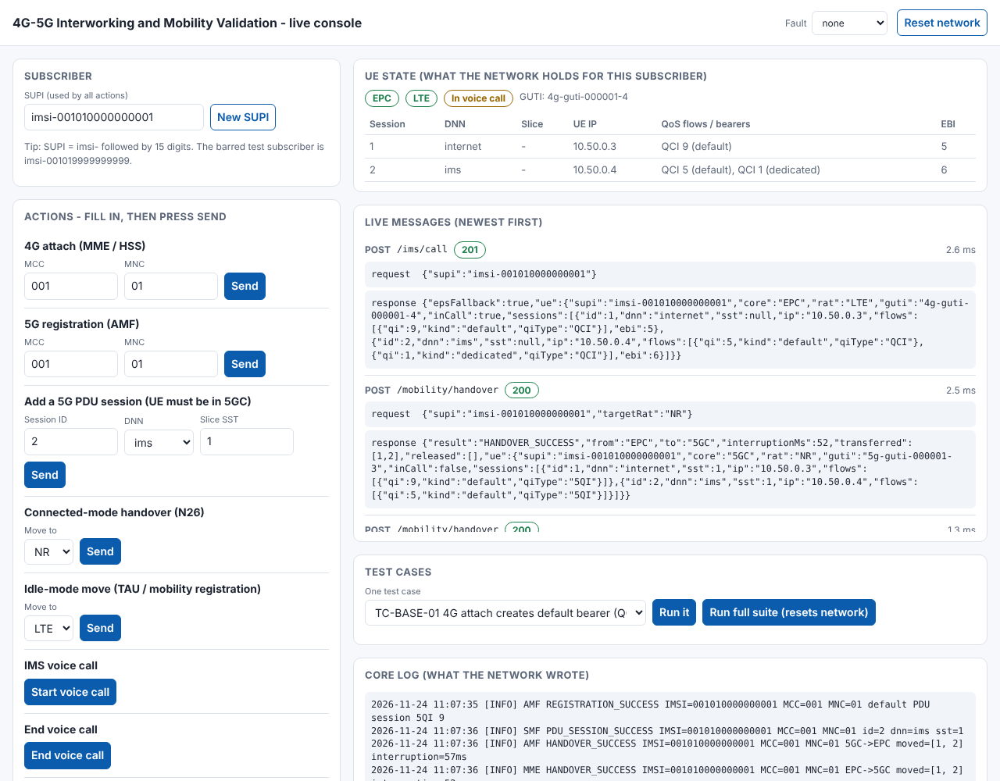
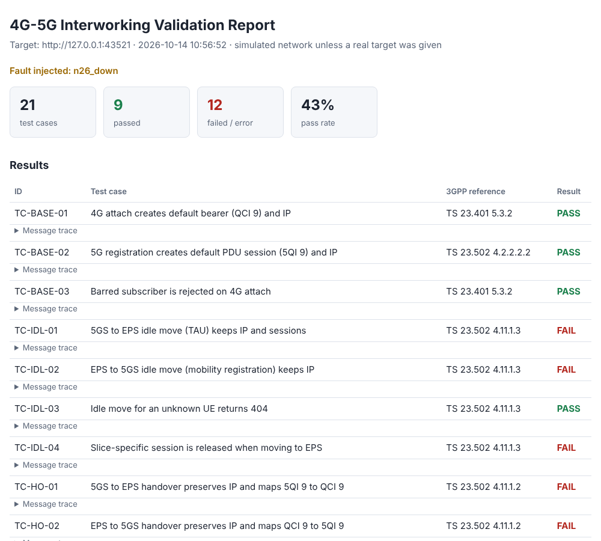

# 4G-5G Interworking and Mobility Validation

Author: Sweekar Mishra

A Python test-automation framework for what happens to a subscriber's sessions when the UE
moves between 4G (EPS: LTE + EPC) and 5G (5GS: NR + 5GC). It runs 21 test cases, records
every request and response, and writes an HTML report with KPIs and log analysis. It also
analyses exported Spirent Landslide results against pass criteria. A live browser console
lets you try each procedure by hand. It runs on any laptop with Python 3 and **no installs**,
because it tests a *simulated* network.



## What it validates

| Area | Test cases | 3GPP reference |
|---|---|---|
| Baseline 4G attach and 5G registration | 3 | TS 23.401, TS 23.502 |
| Idle-mode move (TAU, mobility registration) | 4 | TS 23.502 4.11.1.3 |
| Connected-mode handover over N26 | 8 | TS 23.502 4.11.1.2 |
| EPS fallback for IMS voice, VoLTE | 6 | TS 23.502 4.13.6.1 |

Checks include: IP address preserved across the move, PDU session to PDN connection
transfer, 5QI to QCI mapping (default 9, IMS 5, voice 1), release of slice-specific sessions
that EPS cannot carry, mapped GUTI assignment, handover interruption against a limit, and
negative cases. One test runs 50 ping-pong round trips (100 handovers) and reports success
rate and interruption time.

## Quick start

Requires Python 3.8 or newer.

```bash
python3 run_suite.py                                   # run all tests, write reports/report.html
python3 run_suite.py --fault n26_down                  # N26 context transfer fails
python3 run_suite.py --fault no_qci1                   # EPS voice bearer setup fails
python3 run_suite.py --landslide-csv landslide/sample_landslide_export.csv
python3 live_console.py                                # live console at http://127.0.0.1:8002
```

Windows: double-click `LIVE_DEMO.bat` (live console) or `RUN_DEMO.bat` (automatic run).
Use `python` or `py` instead of `python3` if needed. Mac/Linux: `bash live_demo.sh`.

## Live console

Register on 5G, add a session, hand over to LTE and back, start a voice call, and watch the
UE's core, RAT, IPs and QoS flows change in the state panel. Switch on a fault to break the
network on purpose, run a single test, or run the full suite and watch it fill in.

## Fault injection

`--fault n26_down` makes N26 context transfer fail: handovers return `500`, idle moves are
rejected, EPS fallback fails, and the log analysis shows `HANDOVER_FAILURE` and `TAU_REJECT`
on AMF and MME.



## Spirent Landslide results

`tools/landslide_report.py` reads an exported results CSV and checks it against the limits in
`landslide/landslide_criteria.json`. Column names come from `landslide/landslide_columns.json`.
See [LANDSLIDE_GUIDE.md](LANDSLIDE_GUIDE.md). The included CSV is a **synthetic sample**.

## How it works

```
 run_suite.py + test_cases.py  -->  simulated EPC + 5GC (sim/interworking_core.py)  -->  core log
          |                                                                                  |
   report.html / results.json                                                tools/log_tracker.py
```

| File | Role |
|---|---|
| `sim/interworking_core.py` | Simulated EPC + 5GC: N26 handover, idle moves, EPS fallback, faults. |
| `test_cases.py` | The 21 test cases. Add one with the `@tc(...)` decorator. |
| `run_suite.py` | Runs the tests, records message traces, writes the report. |
| `tools/log_tracker.py` | Parses the core log with regular expressions. |
| `tools/landslide_report.py` | Landslide results parser with pass criteria. |
| `live_console.py` / `live_console.html` | The interactive console. |

## Scope and limits

- The network is a **simulation**: simplified payloads over HTTP/1.1, no RAN or RRC
  behaviour, and interruption times are model values, not measurements.
- The Landslide parser has been demonstrated on synthetic data only. Real exports may use
  different column names.
- All data is synthetic (test PLMN 001/01). No operator or vendor data is included.

## Roadmap

- Drive a real EPC + 5GC testbed (for example Open5GS with a UE/RAN simulator).
- Add PCAP checks and more interworking cases.
- Run the Landslide parser on real exports.

## How this was built

Developed with the help of an AI assistant (Claude) as a learning and prototyping aid. The
design, the telecom test scenarios and the review of the results are the author's.

## License

MIT, see [LICENSE](LICENSE).
